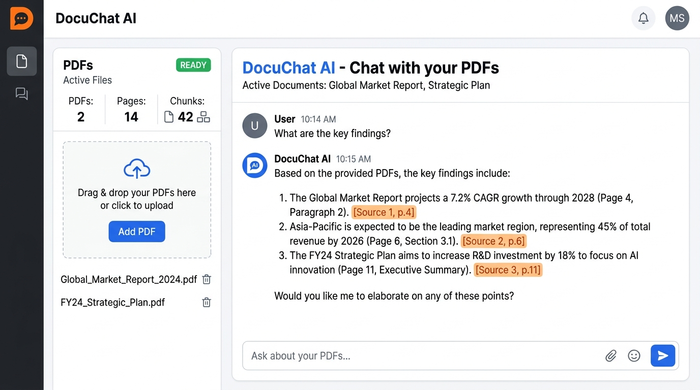
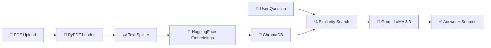

<div align="center">

# 📄 DocuChat AI

### **Chat with any PDF using AI-powered RAG**

[](https://www.python.org/)
[](https://streamlit.io/)
[](https://www.langchain.com/)
[](https://groq.com/)
[](https://www.trychroma.com/)
[](LICENSE)

*Upload any PDF, ask questions in natural language, and get precise answers with source citations — powered by Retrieval-Augmented Generation (RAG).*

---



</div>

---

## ✨ Features

| Feature | Description |
|---------|-------------|
| 📁 **Multi-PDF Upload** | Upload and process multiple PDF files simultaneously |
| 🤖 **AI-Powered Q&A** | Ask natural language questions and get accurate answers |
| 📄 **Source Citations** | Every answer includes page references for verification |
| 🧠 **RAG Architecture** | Retrieval-Augmented Generation ensures factual, grounded responses |
| ⚡ **Blazing Fast** | Groq's LPU inference engine delivers sub-second LLM responses |
| 🎨 **Modern UI** | Clean, responsive Streamlit interface with status indicators |
| 💾 **Persistent Storage** | ChromaDB vector store persists across sessions |

---

## 🏗️ Architecture



### How It Works

1. **Load** — PDFs are parsed page-by-page using `PyPDFLoader`
2. **Split** — Documents are chunked into 1000-character segments with 200-character overlap
3. **Embed** — Chunks are embedded using `all-MiniLM-L6-v2` sentence transformer
4. **Store** — Embeddings are stored in ChromaDB for fast vector similarity search
5. **Retrieve** — User questions are embedded and matched to the top-3 most relevant chunks
6. **Generate** — Context + question are sent to `LLaMA 3.3 70B` via Groq for answer generation

---

## 🚀 Quick Start

### Prerequisites

- **Python 3.10+**
- **Groq API Key** — [Get one free here](https://console.groq.com/keys)

### Installation

```bash
# Clone the repository
git clone https://github.com/Innovative-Minds12/DocuChat-AI.git
cd DocuChat-AI

# Create a virtual environment
python -m venv .venv

# Activate it
# Windows:
.venv\Scripts\activate
# macOS/Linux:
source .venv/bin/activate

# Install dependencies
pip install -r requirements.txt
```

### Configuration

```bash
# Copy the example environment file
cp .env.example .env

# Edit .env and add your Groq API key
GROQ_API_KEY=gsk_your_actual_api_key_here
```

### Run the App

```bash
streamlit run app.py
```

The app will open at **http://localhost:8501** 🎉

---

## 📂 Project Structure

```
DocuChat-AI/
├── app.py                  # Streamlit UI & main application
├── rag_pipeline.py         # RAG orchestration (build KB + ask)
├── utils/
│   ├── pdf_loader.py       # PDF loading with PyPDFLoader
│   ├── splitter.py         # Recursive text chunking
│   └── vector_store.py     # ChromaDB create/load operations
├── requirements.txt        # Python dependencies
├── .env.example            # Environment variable template
├── .gitignore              # Git ignore rules
├── assets/
│   └── demo-screenshot.jpg # App screenshot
└── README.md               # You are here!
```

---

## 🛠️ Tech Stack

<div align="center">

| Layer | Technology | Purpose |
|-------|-----------|---------|
| **Frontend** | Streamlit | Interactive web UI with chat interface |
| **LLM** | Groq (LLaMA 3.3 70B) | Ultra-fast AI answer generation |
| **Framework** | LangChain | RAG pipeline orchestration |
| **Embeddings** | HuggingFace `all-MiniLM-L6-v2` | Document & query embedding |
| **Vector DB** | ChromaDB | Persistent vector similarity search |
| **PDF Parser** | PyPDF | PDF text extraction |

</div>

---

## 📖 Usage Guide

1. **Upload PDFs** — Use the sidebar file uploader to select one or more PDF files
2. **Build Knowledge Base** — Click the "▶ Build Knowledge Base" button and wait for processing
3. **Ask Questions** — Type your question in the chat input and press Enter
4. **View Sources** — Check the orange source tags below each answer for page references
5. **Clear Chat** — Use the "🗑 Clear Chat" button to reset the conversation

---

## ⚙️ Configuration Options

| Parameter | Location | Default | Description |
|-----------|----------|---------|-------------|
| `chunk_size` | `utils/splitter.py` | `1000` | Characters per text chunk |
| `chunk_overlap` | `utils/splitter.py` | `200` | Overlap between consecutive chunks |
| `k` | `rag_pipeline.py` | `3` | Number of retrieved chunks per query |
| `model` | `rag_pipeline.py` | `llama-3.3-70b-versatile` | Groq LLM model |
| `embedding model` | `utils/vector_store.py` | `all-MiniLM-L6-v2` | Sentence transformer model |

---

## 🤝 Contributing

Contributions are welcome! Here's how:

1. **Fork** the repository
2. **Create** a feature branch (`git checkout -b feature/amazing-feature`)
3. **Commit** your changes (`git commit -m 'Add amazing feature'`)
4. **Push** to the branch (`git push origin feature/amazing-feature`)
5. **Open** a Pull Request

---

## 📄 License

This project is licensed under the **MIT License** — see the [LICENSE](LICENSE) file for details.

---

## 🙏 Acknowledgments

- [LangChain](https://www.langchain.com/) — RAG framework
- [Groq](https://groq.com/) — Ultra-fast LLM inference
- [Streamlit](https://streamlit.io/) — Python web app framework
- [ChromaDB](https://www.trychroma.com/) — Open-source vector database
- [HuggingFace](https://huggingface.co/) — Embedding models

---

<div align="center">

**Built with ❤️ by [Innovative-Minds12](https://github.com/Innovative-Minds12)**

⭐ *Star this repo if you found it useful!* ⭐

</div>
